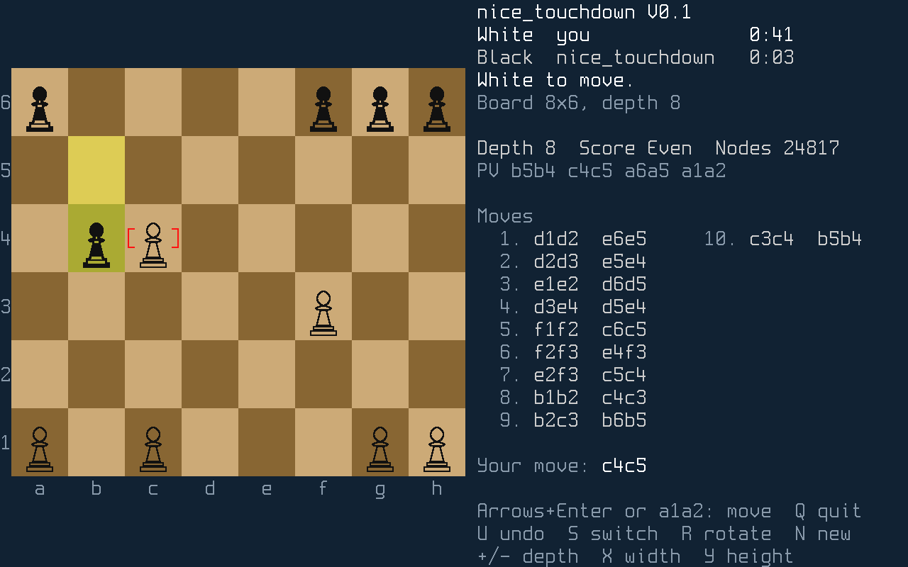

# nice_touchdown

The game of TouchDown for the NICE system.

It will run on the MEGA65 with the board shown on the screen, and moves
entered by the keyboard, in the same way as
[nice_chess](https://github.com/MJoergen/nice_chess). The rules are
those of [touchdown_db](https://github.com/MJoergen/touchdown_db), which
solves the 4x4 board.

Status: the board, the move generator, and the text front end are
built and tested; the engine's search and the screen are not built
yet, and `go` plays the first legal move. This
README is the design. Each section says what is planned for the first
version, and the last section what may come after.

## The game

TouchDown is played with pawns only. White starts with a pawn on each
square of rank 1, and Black with a pawn on each square of the last
rank. White moves first. (touchdown_db calls White `X` and Black `O`.)

A pawn moves in one of two ways:

- one square straight forward, if that square is empty;
- one square diagonally forward, if an enemy pawn is there. The enemy
  pawn is removed.

A player wins by moving a pawn to the opponent's back rank. A player
with no legal move, or no pawns, loses.

There are no draws: every game ends with a winner, since every move
takes a pawn one rank forward. On the 4x4 board the player to move
first wins (touchdown_db).

Moves are written as in chess, from-square then to-square, such as
`b1b2` or `c3d4`. Files are `a` to `l`, ranks `1` to `6`.

## Board sizes

The board has 4 to 6 ranks (rows) and 4 to 12 files (columns). Each
combination is allowed, from 4x4 to 12x6 (files x ranks). The default
is 8x6.

The limits come from the screen and the engine:

- The screen is 80x25 characters of 16x32 pixels. A square is 3
  characters high and shows a pawn of 3x3 characters. Up to 8 files a
  square is 5 characters wide, as in nice_chess; above 8 files it is 3
  wide. The board then fits in the left half, 41 columns, and 24 rows.
- A rank of at most 12 squares fits in 16 bits, so two ranks fit in one
  32-bit word of NICE, and a side's pawns in 3 words (The engine,
  below).

## The screen

A proposed screen of the windowed front end, 8x6, after White's move
`c3c4` and Black's `b5b4`. It is a mockup, drawn by `tools/mockup.py`,
not a dump of the program, in nice_chess's font (Spleen 16x32, from
nice_cpu's emulator) and colors:

The left half is the board, White at the bottom. The last move is
shown in yellow, and the cursor by red brackets. The right half has,
top to bottom:

- the title and the version;
- the players and their clocks, the side to move bright;
- the status: who is to move, or who won;
- the size of the board and the depth of the engine's search;
- the engine's last search: its depth, its score, its nodes, and its
  principal variation;
- the moves of the game, in two columns of 9;
- the move being typed;
- the keys.

The same screen on the largest board, 12x6, with squares 3 characters
wide; there the cursor is shown by the color of its square, green on j2:

## Playing

The keys follow nice_chess:

- Cursor keys and RETURN, or a typed move such as `a1a2` and RETURN:
  move. Space is RETURN, INST/DEL erases a typed move, and ESC drops a
  pawn picked up or a typed move.
- U: undo a move.
- S: switch sides.
- R: rotate the board.
- N: a new game.
- \+ and −: the depth of the engine's search.
- W: the next width, 4 to 12 files, and a new game.
- H: the next height, 4 to 6 ranks, and a new game.
- ESC while the engine thinks: make it move now.
- Q: clear the screen and return to the monitor.

## Front ends

As in nice_chess, the engine is one set of C files, with no I/O, no
clock, and no malloc, built for NICE and for the host. Around it:

- the windowed front end, for the MEGA65 (under NiceMonMEGA65's
  monitor) and for niceemu's window;
- the text front end, for the board's debug UART or Ethernet, for
  niceemu, and for a terminal on the host.

The text front end has commands such as:

    new 8x6        a new game on a board of 8 files and 6 ranks
    position TEXT  set up a position, such as OOOO/..../..../XXXX x
    a1a2           make a move
    moves          list the legal moves
    undo           take back the last move
    go             the engine moves
    go depth 6     the engine searches to depth 6 and moves
    d              show the board
    perft 5        count the positions 5 moves ahead
    divide 5       perft 5, for each legal move
    help           list the commands

A position as text has its ranks from the last down to rank 1, divided
by `/`, with `X` for White's pawn, `O` for Black's, and `.` for an
empty square, as touchdown_db writes them, then the side to move, `x`
or `o`.

`perft` checks the move generator against a count made another way,
and `go depth N` gives the same move every time, so both are good
tests.

## The engine

The first version is simple on purpose. Later versions are measured
against it.

### The search

A negamax search with alpha-beta pruning to a fixed depth, set by + and
−. There is no iterative deepening, no transposition table, and no
time control yet.

Moves are tried in a fixed order: moves to the last rank first, then
captures, then the rest. The order changes only the speed, not the
result.

### The evaluation

A position has one of three values, from the side to move:

- **Win**: the side to move wins, whatever the opponent does, within
  the depth searched.
- **Loss**: the opponent wins, within the depth.
- **Even**: neither is proved within the depth.

At a leaf the evaluation is Even, unless the game is over. Since there
are no draws in TouchDown, Even does not mean a draw: it means "not
known yet". A Win or a Loss found by the search is exact.

A Win is stored as a large number less the number of plies to it, so
the engine prefers the fastest win and, when every move loses, the
slowest loss. Among Even moves it picks one at random, so the games
differ; in niceemu the seed is fixed, so a run is the same each time.

The screen shows the score as `Even`, `Win in N` or `Loss in N`, where
N counts plies.

### The board

Each side's pawns are a bitboard of 6 ranks of 16 bits each: three
32-bit words, two ranks per word, of which up to 12 bits of a rank are
used. A move one rank forward is a shift by 16 bits, and a diagonal
move a shift by 15 or 17 bits, masked at the edge files. The moves of
all pawns of a side are then found with a few shifts and masks, with
no loop over squares.

### Checking it

The 4x4 board can be checked against touchdown_db: at a depth large
enough to reach the end of every game, the engine's value of each
position must be touchdown_db's. For larger boards, perft counts from
the host build are compared with those of a plain, slow move
generator.

## After the first version

The first version is the baseline. Ways to make it stronger, each
measured by matches against the version before:

- **A better search**: iterative deepening, a transposition table with
  Zobrist keys, killer moves, and a time control, as in nice_chess.
- **A neural network evaluation**: a small network that gives each
  position a probability of a win in place of Even. touchdown_db's
  `touchdown_nn.py` already trains such networks on the 4x4 board,
  with accuracies of 99.15% to 99.99%. On NICE the network must use
  integer weights, and be small enough in words and in steps a node.
- **An endgame tablebase**: the exact value of every position with few
  pawns, made on the host as touchdown_db does, and stored in the
  program or loaded from the SD card. The search stops at a position
  in the table.
- **An opening book**: positions near the start, searched deeply on
  the host, with the best moves stored in the program.
- **Solving boards**: with a tablebase and a deep search, finding the
  value of the start position of boards larger than 4x4.

## Building

As in nice_chess: `make deps all` fetches nice_cpu and niceemu into
`deps/` and builds the front ends, and `make test` runs the tests on
the host and in niceemu. CONTRIBUTING.md has the details.

`tools/mockup.py` draws the mockups above. It needs Pillow and the
font of nice_cpu's emulator, by default from a nice_chess checkout
next to this one:

    tools/mockup.py doc/mockup.png
    tools/mockup.py --cols 12 doc/mockup_12x6.png
    tools/mockup.py --font PATH/emulator/src/font.zig doc/mockup.png

## License

MIT, in [LICENSE](LICENSE).
