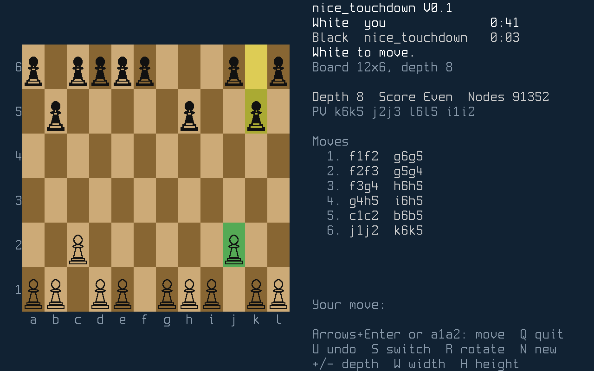

# nice_touchdown

The game of TouchDown for the NICE system.

It will run on the MEGA65 with the board shown on the screen, and moves
entered by the keyboard, in the same way as
[nice_chess](https://github.com/MJoergen/nice_chess). The rules are
those of [touchdown_db](https://github.com/MJoergen/touchdown_db), which
solves the 4x4 board.

Status: V1.0, the first version, is released, and V1.1 adds an
evaluation learned by self-play, which this README describes too;
[RELEASE_NOTES.md](RELEASE_NOTES.md) says what each release has. This
README is the design. Its last section says what may come after.

## The game

TouchDown is played with pawns only. White starts with a pawn on each
square of rank 1, and Black with a pawn on each square of the last
rank. White moves first. (touchdown_db calls White `X` and Black `O`.)

A pawn moves in one of two ways:

- one square straight forward, if that square is empty;
- one square diagonally forward, if an enemy pawn is there. The enemy
  pawn is removed.

A player wins by moving a pawn to the opponent's back rank. A player
with no legal move, or no pawns, loses.

There are no draws: every game ends with a winner, since every move
takes a pawn one rank forward. On the 4x4 board the player to move
first wins (touchdown_db); [Solved boards](#solved-boards) has the
other sizes.

Moves are written as in chess, from-square then to-square, such as
`b1b2` or `c3d4`. Files are `a` to `l`, ranks `1` to `6`.

## Board sizes

The board has 4 to 6 ranks (rows) and 4 to 12 files (columns). Each
combination is allowed, from 4x4 to 12x6 (files x ranks). The default
is 8x6.

The limits come from the screen and the engine:

- The screen is 80x25 characters of 16x32 pixels. A square is 3
  characters high and shows a pawn of 3x3 characters. Up to 8 files a
  square is 5 characters wide, as in nice_chess; above 8 files it is 3
  wide. The board then fits in the left half, 41 columns, and 24 rows.
- A rank of at most 12 squares fits in 16 bits, so two ranks fit in one
  32-bit word of NICE, and a side's pawns in 3 words (The engine,
  below).

## The screen

A proposed screen of the windowed front end, 8x6, after White's move
`c3c4` and Black's `b5b4`. It is a mockup, drawn by `tools/mockup.py`,
not a dump of the program, in nice_chess's font (Spleen 16x32, from
nice_cpu's emulator) and colors:

The left half is the board, White at the bottom. The last move is
shown in yellow, and the cursor by red brackets. The right half has,
top to bottom:

- the title and the version;
- the players and their clocks, the side to move bright;
- the status: who is to move, or who won;
- the size of the board and the depth of the engine's search;
- the engine's last search: its depth, its score, its nodes, and its
  principal variation;
- the moves of the game, in two columns of 9;
- the move being typed;
- the keys.

The same screen on the largest board, 12x6, with squares 3 characters
wide; there the cursor is shown by the color of its square, green on j2:

## Playing

The keys follow nice_chess:

- Cursor keys and RETURN, or a typed move such as `a1a2` and RETURN:
  move. Space is RETURN, INST/DEL erases a typed move, and ESC drops a
  pawn picked up or a typed move.
- U: undo a move.
- S: switch sides.
- R: rotate the board.
- N: a new game.
- \+ and −: the depth of the engine's search.
- X: the next width, 4 to 12 files, and a new game.
- Y: the next height, 4 to 6 ranks, and a new game.

Letters are the same in either case, so CAPS LOCK does not matter, and
the letters of the commands are none of the files, a to l.
- ESC while the engine thinks: make it move now.
- Q: clear the screen and return to the monitor.

## Front ends

As in nice_chess, the engine is one set of C files, with no I/O, no
clock, and no malloc, built for NICE and for the host. Around it:

- the windowed front end, for the MEGA65 (under NiceMonMEGA65's
  monitor) and for niceemu's window;
- the text front end, for the board's debug UART or Ethernet, for
  niceemu, and for a terminal on the host. It is for development and
  the tests: a release has the windowed front end only.

The text front end has commands such as:

    new 8x6        a new game on a board of 8 files and 6 ranks
    position TEXT  set up a position, such as OOOO/..../..../XXXX x
    a1a2           make a move
    moves          list the legal moves
    undo           take back the last move
    go             the engine searches to the depth set and moves
    go depth 6     the engine searches to depth 6 and moves
    depth 10       the depth of go, 1 to 32 (6 at first)
    eval off       the search without its evaluation, as the first
                   version's (eval on, at first)
    seed 1         the seed of the engine's choice among moves as good
    d              show the board
    perft 5        count the positions 5 moves ahead
    divide 5       perft 5, for each legal move
    help           list the commands

A position as text has its ranks from the last down to rank 1, divided
by `/`, with `X` for White's pawn, `O` for Black's, and `.` for an
empty square, as touchdown_db writes them, then the side to move, `x`
or `o`.

`perft` checks the move generator against a count made another way,
and `go depth N` gives the same move every time, so both are good
tests.

## The engine

The first version is simple on purpose: its search has no evaluation
(`eval off`). Later versions are measured against it.

### The search

A negamax search with alpha-beta pruning to a fixed depth, set by + and
−. There is no iterative deepening, no transposition table, and no
time control yet.

Moves are tried in a fixed order: moves to the last rank first, then
captures, then the rest. The order changes only the speed, not the
result.

### The evaluation

A position has a value from the side to move:

- **Win**: the side to move wins, whatever the opponent does, within
  the depth searched.
- **Loss**: the opponent wins, within the depth.
- Otherwise, neither is proved within the depth, and the value is the
  evaluation's: the probability that the side to move wins.

A Win or a Loss found by the search is exact. A Win is stored as a
large number less the number of plies to it, so the engine prefers
the fastest win and, when every move loses, the slowest loss. Among
the moves of the best value that is not proved it picks one at
random, so the games differ; in niceemu the seed is fixed, so a run
is the same each time.

The evaluation is an N-tuple network, as nice_othello's. A window of
3 files by 2 ranks is placed at every place on the board, from the
view of the side to move; its 6 squares are each empty, the side's,
or the opponent's, so it is in one of 729 states, and each state has
a weight. The evaluation is the sum of the weights of all the windows:
the logit of the probability of a win, in hundredths. The windows of
all files share one table, so that the weights hold for every width
of the board; there is a table for each number of ranks and each pair
of ranks, and in each for the windows inside the board and at its
edges (mirrored, so that the left and right edges share them). That
is 17496 weights of 16 bits, 8748 words. An evaluation is a few table
lookups a window, with no multiplication.

`tools/train.c` learns the weights by self-play on the host, with
TD(λ), on boards of every size (`make weights`, five minutes on one
core). It checks them against touchdown_db: of the positions of the
4x4 board that can come from the start, and are not won by a move to
the last rank at once, the sign of the evaluation alone is right for
85%, where always guessing the more common value is right for 60%.
Weights learned on every size but 4x4 are right for 84%: what is
learned on the other sizes holds on one never seen.

`eval off` turns the evaluation off: the value of a position not
proved is then Even, as in the first version, against which the
engine is measured. In matches of 200 games from random openings,
each played with both colors, the evaluation wins 95 to 99% at the
same depth, on 8x6 and 12x6, and at depth 6 it wins 89 to 94% against
depth 8 without it, with fewer nodes.

The screen shows the score as `Win in N` or `Loss in N`, where N
counts plies, or as the probability of a win, such as `62%`; or
`Even`, with the evaluation off; or `Win` or `Loss`, the opening
book's.

The opening book has the value of the start of each size that is
solved (Solved boards, below): if White wins, a move that wins; if
White loses, for each move of White's, a move of Black's that wins.
There the engine shows `Win` or `Loss` without the plies, which the
book does not know, and plays the book's move, unless its search
proves a Win or a Loss itself. After the book's first move of each
side, the search goes on alone, and does not know the way to the win.
The book is 21 sizes in 151 numbers of 16 bits, which `make book` writes into
`src/engine/book.h` by the solver.

The probability is calibrated: of the positions it shows as 70 to
80%, about three in four are a win. The score of the search is too
careful by itself, as the self-play learns from games with many moves
at random, and it leaves out that the side to move has the move: of
the positions of games that the solver finds the value of, those of a
score of 0, which would be 50%, are a win for the side to move 61% of
the time, and those of 0.5, which would be 62%, 77% of the time. So
the probability shown is a table of the score, fitted to the values
of 13000 positions of games on 6x6 to 12x6, from move 8 on, at depths
4 to 8 (`make calibrate`). On positions of other games, at depth 6,
it is within 4 points in each tenth; the score taken as it is was 10
to 25 points too low above 50%, and as much too high below.

### The board

Each side's pawns are a bitboard of 6 ranks of 16 bits each: three
32-bit words, two ranks per word, of which up to 12 bits of a rank are
used. A move one rank forward is a shift by 16 bits, and a diagonal
move a shift by 15 or 17 bits, masked at the edge files. The moves of
all pawns of a side are then found with a few shifts and masks, with
no loop over squares.

### Checking it

The 4x4 board is checked against touchdown_db: at depth 24, which
reaches the end of every game, the engine's value of each of its
755591 positions is touchdown_db's, the move it plays in a win leads
to a loss for the opponent, and a win in N is followed by a loss in
N - 1. So are 6x4 and 5x5, against the solver's database of every
position that can come from the start (Solved boards), which this
checks too. For every size, the move generator is checked against a plain,
slow one, at every node of the move tree from the start and of games
at random to their end.

The evaluation alone, without a search, is measured against them too
(the tests `evaldb`): of the positions that can come from the start
and are not won at once, its sign is the value of 85% of 4x4's, 89%
of 6x4's, 86% of 5x5's, and 85% of 4x6's; of all the 4x4 positions
not won at once, of 72%.

The evaluation is checked against the trainer's own: in every
position of 2700 games at random on every size, it is the sum of the
weights of the trainer's windows.

Without the evaluation, the search costs about 450 steps a node in
niceemu, and depth 8 from the start takes 0.4 seconds on the MEGA65
on 8x6 and 3.2 seconds on 12x6. With the evaluation, a node costs
about 1100 steps on 8x6, and the search, which no longer has the many
equal values of Even to cut off, takes more nodes: from the start,
each ply takes 5 to 6 times the one before. Depth 6 takes 0.5 seconds on 8x6
and 2.8 seconds on 12x6, and depth 7 2.3 and 17 seconds: so depth 6
is the default.

### Solved boards

`tools/solve.c` solves the start of a board on the host, by a
depth-first search with a table of the positions it has solved
and a rule of races of pawns that nothing can stop (CONTRIBUTING.md
has how). With best play, the first player, White:

| Ranks \ Files  | 4   | 5   | 6   | 7   | 8   | 9   | 10  | 11  | 12 |
|---------------|-----|-----|-----|-----|-----|-----|-----|-----|----|
| 4             | win | loss | loss | win | loss | win | win | loss | win |
| 5             | loss | win | loss | win | win | win | win |     |    |
| 6             | win | win | loss | loss | win | ?   |     |     |    |

Up to 7x4 and 6x5, the solver also writes the value of every position
that can come from the start: 13 million of 6x5, 540 MB as text. The
tests and the trainer check against them.

The default board, 8x6, is a win for White, found in under 2 minutes
with 16 threads; 10x5, the largest solved, took 32 minutes. The sizes
left empty are not solved yet. The engine's opening book has the
sizes solved.

## After the first version

The first version is the baseline. Ways to make it stronger, each
measured by matches against the version before:

- **A better search**: iterative deepening, a transposition table with
  Zobrist keys, killer moves, and a time control, as in nice_chess.
- **A better evaluation**: more windows, such as 2 files by 3 ranks,
  or 3 by 3, which knows 92% of the 4x4 positions above where 3 by 2
  knows 88%, in as many words as the MEGA65 has to spare; and an
  evaluation kept up to date as moves are made, rather than summed at
  each leaf. touchdown_db's `touchdown_nn.py` trains networks of
  hidden layers on the 4x4 board, with accuracies of 99.15% to
  99.99%, but for that size only.
- **An endgame tablebase**: the exact value of every position with few
  pawns, made on the host as touchdown_db does, and stored in the
  program or loaded from the SD card. The search stops at a position
  in the table.
- **An opening book**: positions near the start, searched deeply on
  the host, with the best moves stored in the program.
- **Solving boards**: the sizes not solved yet (Solved boards), with a
  larger table, kept on disk, or a tablebase of the endings.

## Building

As in nice_chess: `make deps all` fetches nice_cpu and niceemu into
`deps/` and builds the front ends, and `make test` runs the tests on
the host and in niceemu. CONTRIBUTING.md has the details.

`tools/mockup.py` draws the mockups above. It needs Pillow and the
font of nice_cpu's emulator, by default from a nice_chess checkout
next to this one:

    tools/mockup.py doc/mockup.png
    tools/mockup.py --cols 12 doc/mockup_12x6.png
    tools/mockup.py --font PATH/emulator/src/font.zig doc/mockup.png

## License

MIT, in [LICENSE](LICENSE).
